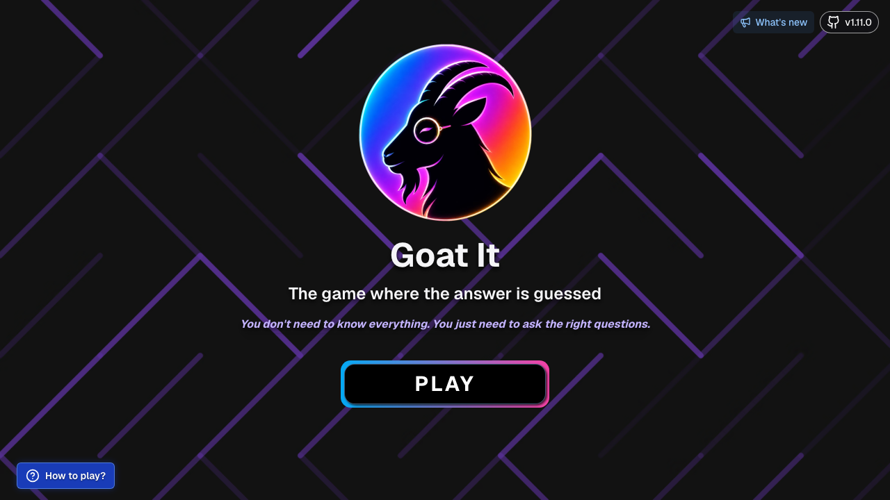
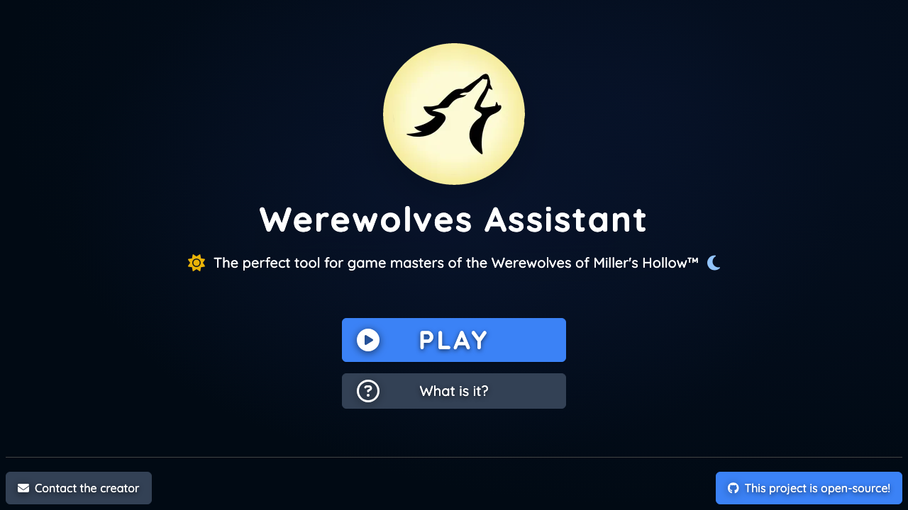

 

## ☕️&nbsp;&nbsp;Glad to see you here, make yourself at home

Hi 👋🏼 ! I'm **Antoine ZANARDI**, a happy and proud ✨ **Web FullStack Developer** ✨ for several years now. I like to contribute upstream to the tools I use (Nuxt, Vitest, Stryker, Oxc...).

| 🔭 Building | 🌱 Learning | 💬 Ask me about |
|:---:|:---:|:---:|
| [Goat It](https://goat-it.fr) 🐐 | Rust 🦀 | Vue, Nuxt, NestJS, testing |

---

## 🚀&nbsp;&nbsp;Featured projects

<table>
  <tr>
    <td width="50%" align="center" valign="top">
      
      <h3><a href="https://goat-it.fr">🐐 Goat It</a></h3>
      
The game where the answer is guessed. You don't need to know everything, you just need to ask the right questions.

      

        
        
        
      

      

    </td>
    <td width="50%" align="center" valign="top">
      
      <h3><a href="https://werewolves-assistant.com">🐺 Werewolves Assistant</a></h3>
      
The perfect tool for game masters of the Werewolves of Miller's Hollow™.

      

    </td>
  </tr>
</table>

---

## 🌟&nbsp;&nbsp;My daily fancy tools

 

 

 

  

---

## 🐍&nbsp;&nbsp;My contribution snake

<picture>
  <source media="(prefers-color-scheme: dark)" srcset="https://raw.githubusercontent.com/antoinezanardi/antoinezanardi/output/github-snake-dark.svg"/>
  <source media="(prefers-color-scheme: light)" srcset="https://raw.githubusercontent.com/antoinezanardi/antoinezanardi/output/github-snake.svg"/>
  
</picture>

---

## 🎆&nbsp;&nbsp;Want to see more ? Here are my stats 👇

